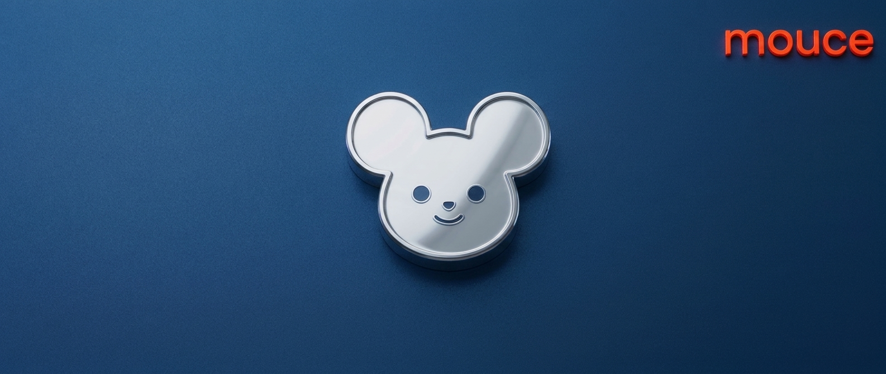

<p align="center">
  
</p>

<h1 align="center">mouce</h1>

<p align="center">
  <strong>A tiny desktop companion that helps you understand what's on your screen, without ever touching your files.</strong>
</p>

<p align="center">
  
  
  
  
  
</p>

<p align="center">
  <a href="#features">Features</a> ·
  <a href="#the-safety-promise">Safety</a> ·
  <a href="#ai-providers">AI providers</a> ·
  <a href="#getting-started">Getting started</a> ·
  <a href="#roadmap">Roadmap</a>
</p>

---

## Overview

mouce is a small, always-on-top companion that sits in a corner of your Windows desktop. It
never takes keyboard focus from the app you're working in. When you want help, it asks the AI
you choose: a free local model through [Ollama](https://ollama.com), or an online provider with
your own API key.

## Features

- **Stays out of your way.** Small, transparent and always on top. It never steals focus,
  stays out of the taskbar and Alt+Tab, and remembers where you dragged it.
- **Shows what it's doing.** It sways gently when idle, moves faster while thinking, dims and
  pulses while looking, and glows when something needs your attention.
- **Your choice of AI.** Run a local model on your own machine, or bring a key for OpenAI,
  Groq, Gemini or Claude. If the online AI fails, it can fall back to the local one.
- **Guided first run.** Detects whether Ollama is installed and running, and downloads a
  starter model only after you confirm.
- **Tray controls.** Open Settings, pause or show mouce, or quit, all from the system tray.
- **Adjustable.** Small, medium or large size, sway on or off, and an optional start with
  Windows.

## The safety promise

mouce can look but never touch. It can never open, change, delete or run anything on your
computer.

| Guarantee | How it's enforced |
| --- | --- |
| No file, process, clipboard or input access | The app contains no file-write, process-launch, clipboard-write or input-synthesis code. An automated scan ([`src-tauri/tests/safety_scan.rs`](src-tauri/tests/safety_scan.rs)) fails the build if such APIs, extra capabilities or extra permissions appear. |
| Writes only to its own folder | A single storage module writes to disk, and only inside the app's data folder. |
| API keys stay secret | Keys are stored in Windows Credential Manager. They are written from Settings and read only by the Rust backend to reach the provider you picked; they never reach the web view. |
| No surprise browsing | The only address the app ever opens in your browser is the Ollama download page. |
| One system change, with your consent | "Start with Windows" adds the app's own startup entry, and only if you turn it on. |

## AI providers

| Provider | Runs on | What you need |
| --- | --- | --- |
| Local (Ollama) | Your computer | [Ollama](https://ollama.com) and one model (first run offers to download it) |
| OpenAI | Online | An OpenAI API key |
| Groq | Online | A Groq API key |
| Gemini | Online | A Google AI Studio API key |
| Claude | Online | An Anthropic API key |

Choosing an online provider means content you ask about is sent to that provider. Nothing is
sent anywhere you didn't pick.

## Getting started

### Install a build

Builds aren't code-signed yet, so the first time you run the installer Windows SmartScreen
will warn that the publisher is unknown. If you trust where the file came from, choose
**More info**, then **Run anyway**.

### Build from source

**Prerequisites** (Windows 11):

- [Node.js](https://nodejs.org)
- [Rust](https://rustup.rs) with the MSVC toolchain
- The WebView2 runtime (already part of Windows 11)

```sh
npm ci
npm run build        # the Rust tests need dist/ to exist, so build the frontend first
npm run tauri dev    # run the app with hot reload
```

To produce a debug executable without an installer:

```sh
npm run tauri build -- --debug --no-bundle
```

### Run the tests

```sh
npx vitest --run             # frontend
cd src-tauri && cargo test   # Rust, including the safety scan
```

## Project structure

```
mouce/
├── src/                  # React + TypeScript UI
│   ├── star/             # the on-screen companion window
│   ├── settings/         # Settings window
│   ├── firstrun/         # first-run setup
│   └── lib/              # IPC bindings and shared types
├── src-tauri/            # Rust backend (Tauri 2)
│   ├── src/ai/           # Ollama, OpenAI-compatible, Gemini and Anthropic clients
│   ├── src/store/        # the only module that writes to disk
│   ├── src/secrets.rs    # API keys in Windows Credential Manager
│   └── tests/            # safety scan
├── docs/                 # design spec and implementation plans
└── images/               # logo and banner
```

## Roadmap

- [x] **Skeleton and safety:** companion window, tray, settings, AI provider layer, secure key
      storage, capability lockdown, safety scan, first run
- [ ] **Chat:** a panel next to mouce with streaming answers and "Look at my screen"
- [ ] **Circle to look up:** draw around anything on screen and ask about it
- [ ] **Dictionary:** Ctrl + right-click a word for its meaning, with an offline fallback
- [ ] **Calendar and reminders:** add events in plain language, confirm before saving, and get
      gentle reminders
- [ ] **Packaging:** a signed Windows installer

The full design is in
[`docs/superpowers/specs/2026-10-27-desktop-star-design.md`](docs/superpowers/specs/2026-10-27-desktop-star-design.md).
